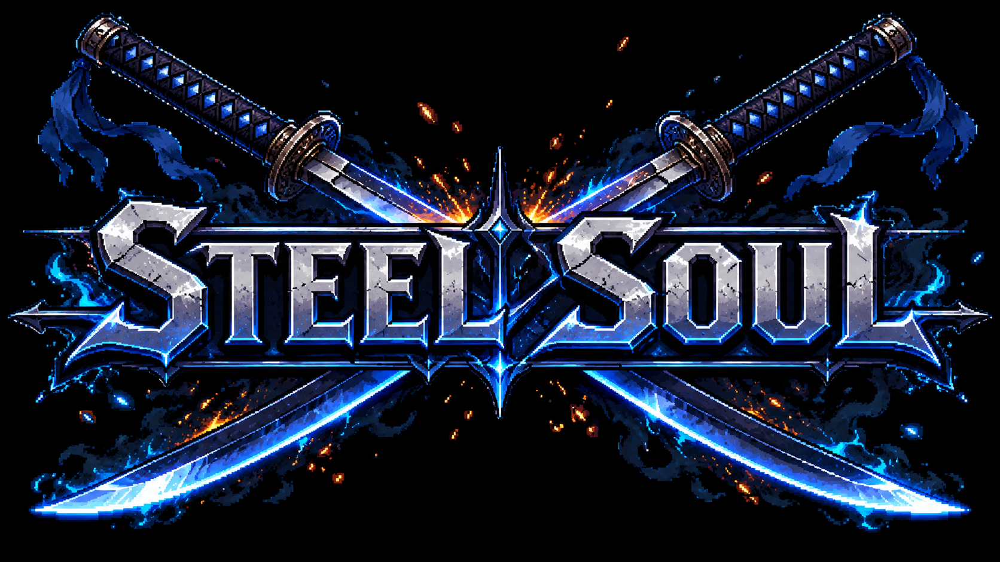
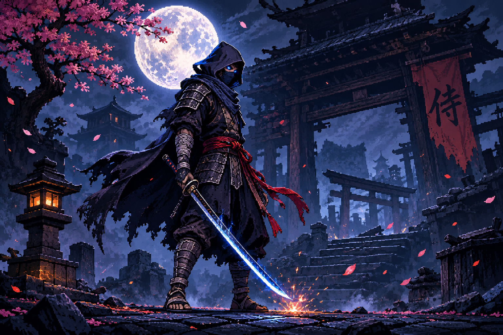
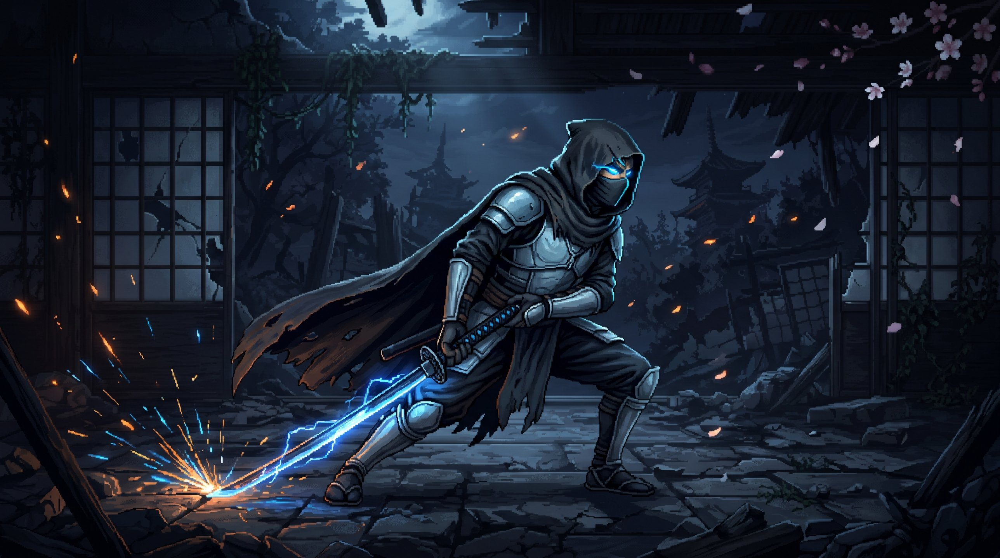
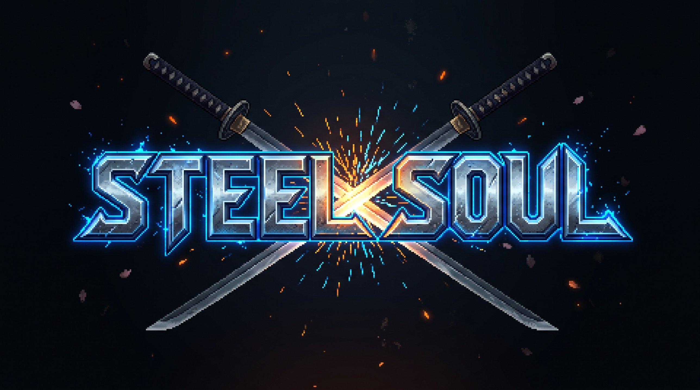

# ⚔️ Steel Soul

**Metroidvania 2D soulslike con combate de artes marciales — Sekiro meets Sifu en pixel art**

> *"Every parry tells a story. Every blade has a soul."*

<p align="center">
  
</p>

<p align="center">
  
</p>

---

## 🎮 Visión del Proyecto

Steel Soul es un metroidvania 2D de acción hardcore con un sistema de combate basado en postura y parry inspirado en **Sekiro**, **Sifu** y **Hollow Knight**, pero con identidad propia: combate cuerpo a cuerpo elaborado estilo kung fu con espadas y armas blancas, donde cada pelea se siente como una coreografía de artes marciales.

El jugador no solo golpea — **lee al enemigo, bloquea, esquiva, rompe su postura y ejecuta**. Cada arma cambia el ritmo del combate. Cada enemigo tiene su propio estilo de lucha. Cada jefe es un duelo que exige maestría.

---

## 🔥 Mecánicas Core

### Sistema de Postura (Posture System)
- Jugador y enemigos tienen **barra de vida + barra de postura**
- Golpes y parries desgastan la postura del oponente
- Cuando la barra de postura se llena → **aturdimiento** → golpe crítico devastador
- La postura se regenera lentamente si dejas de atacar (incentiva la agresividad)
- Cuanta menos vida, más lento se regenera la postura (como Sekiro)

### Parry y Deflexión
- **Parry perfecto** (timing justo): redirige todo el daño a la postura del enemigo, sin daño al jugador
- **Bloqueo normal** (timing tardío): reduce daño pero desgasta tu postura
- **Fallo de bloqueo**: daño completo + gran pérdida de postura
- Ventana de parry ajustable por dificultad (frames)

### Esquiva y Movilidad
- **Dash** con i-frames (momentos de invulnerabilidad)
- **Doble salto** (desbloqueable)
- **Wall jump / wall slide**
- **Dash aéreo** (desbloqueable)
- **Parry aéreo** — se puede parry en el aire, habilitando combates verticales épicos

### Sistema de Armas
Cada arma tiene stats únicos que cambian completamente el estilo de combate:

| Arma | Velocidad | Daño | Desgaste Postura | Rango | Peso |
|------|-----------|------|------------------|-------|------|
| Katana | Media | Medio | Alto | Medio | Medio |
| Ninjato | Rápida | Bajo | Medio | Corto | Ligero |
| Espadón / Nodachi | Lenta | Alto | Muy alto | Largo | Pesado |
| Cuchillos / Dagas | Muy rápida | Bajo | Bajo | Muy corto | Muy ligero |
| Kunais (lanzables) | - | Bajo | Ninguno | A distancia | - |
| Espada de esgrima | Rápida | Medio | Medio | Medio-largo | Ligero |
| Nunchakus | Rápida | Medio | Medio | Corto | Ligero |
| Bo (bastón) | Media | Bajo | Alto | Largo | Medio |

- El **peso** del arma afecta la velocidad de movimiento y de dash
- Cada arma tiene **combos únicos** (secuencias de ataques encadenados)
- Las armas se desbloquean derrotando jefes o encontrándolas en el mapa

### Resistencias por Enemigo
- Cada enemigo tiene resistencias/debilidades a tipos de arma
- Enemigos con armadura pesada: **inmunes a kunais y armas ligeras**, vulnerables a espadón
- Enemigos ágiles: **esquivan ataques lentos**, vulnerables a cuchillos y ninjato
- Algunos jefes requieren **arma específica o estrategia específica** para ser dañados
- Esto obliga al jugador a **pensar qué equipar** antes de cada zona

### Combate Aéreo
- Ataques aéreos descendentes (plunging attack)
- Lanzar al enemigo al aire con uppercut y seguir con combo aéreo
- Parry en el aire contra enemigos voladores o ataques aéreos
- Peleas de jefes con fases aéreas (plataformas, saltos entre paredes)

---

## 🗺️ Estructura Metroidvania

### Mapa Interconectado
- Mundo no lineal con zonas conectadas entre sí
- Zonas bloqueadas que se abren con nuevas habilidades (doble salto, dash, wall climb)
- Atajos que conectan zonas lejanas (puertas, ascensores, pasadizos secretos)
- Mapa que se revela mientras exploras

### Puntos de Descanso (Shrines / Dojos)
- Recuperan vida y postura máxima
- Respawnean todos los enemigos (como hogueras de Dark Souls)
- Permiten cambiar de arma equipada
- Permiten subir de nivel / gastar puntos de habilidad
- Fast travel entre dojos desbloqueados

### Zonas del Mundo (diseño pendiente)
- Cada zona con estética, enemigos y jefe propio
- Mínimo 6-8 zonas interconectadas
- Zona hub central (el dojo del maestro)
- Zonas secretas opcionales con jefes y armas ocultas

---

<p align="center">
  
</p>

## 📈 Progresión del Personaje

### Stats
- **Fuerza** — daño de ataques
- **Agilidad** — velocidad de ataque y movimiento
- **Resistencia** — postura máxima y regeneración
- **Vitalidad** — vida máxima

### Árbol de Habilidades
- **Rama Ofensiva**: combos nuevos, ataques cargados, ejecuciones especiales
- **Rama Defensiva**: parry window más amplio, contra-ataque automático tras parry perfecto, reducción de daño
- **Rama Movilidad**: doble salto, dash aéreo, wall jump, wall climb
- **Rama Armas**: movimientos especiales por tipo de arma

### Moneda / XP
- Los enemigos sueltan "almas" / moneda al morir
- Se pierden al morir (puedes recuperarlas volviendo al punto de muerte)
- Se gastan en el dojo para subir stats y desbloquear habilidades

---

## 🎨 Estilo Visual

- **Pixel art** detallado (resolución 320x180 o 384x216 escalado)
- Paleta oscura con acentos de color por zona
- Animaciones fluidas de combate (mínimo 8-12 frames por ataque)
- **Hitstop** (micro-pausa en impacto) para que los golpes se sientan pesados
- **Screen shake** sutil en golpes críticos y parries perfectos
- Partículas de chispas en choques de espadas
- Efectos de slash trails en los ataques

---

## 🎵 Audio

- Música ambiental por zona (oscura, atmosférica)
- Música de combate intensa para jefes
- SFX de impacto metálico satisfactorio para parries
- SFX diferenciado por tipo de arma
- Herramientas gratuitas: LMMS, Audacity, freesound.org, opengameart.org

---

## 🛠️ Stack Técnico

| Componente | Herramienta | Coste |
|-----------|-------------|-------|
| Motor | **Godot 4.x** (GDScript) | Gratis |
| Sprites/Arte | Aseprite o **LibreSprite** | Gratis (LibreSprite) |
| Mapas | TileMap de Godot + Tiled (opcional) | Gratis |
| Música | LMMS | Gratis |
| SFX | Audacity + freesound.org | Gratis |
| Control de versiones | Git + GitHub | Gratis |
| Assets externos | itch.io, OpenGameArt.org | Gratis |

---

## 🎯 Referentes

| Juego | Qué tomamos |
|-------|-------------|
| **Sekiro** | Sistema de postura, parry como mecánica central, agresividad recompensada |
| **Sifu** | Sensación de pelea de kung fu real, fluidez de combate, coreografía |
| **Nine Sols** | Prueba de que Sekiro funciona en 2D metroidvania |
| **Hollow Knight** | Exploración metroidvania, diseño de mapa, atmósfera |
| **Dead Cells** | Variedad de armas, ritmo de combate, game feel |
| **Celeste** | Precisión de controles de plataformas |

---

## ✅ Roadmap / Checklist de Desarrollo

### Fase 0 — Setup del Proyecto
- [ ] Crear proyecto en Godot 4
- [ ] Configurar estructura de carpetas (scenes, scripts, sprites, audio, maps)
- [ ] Configurar resolución base y escalado de píxeles
- [ ] Primer commit con estructura limpia

### Fase 1 — Prototipo de Movimiento
- [ ] Personaje con movimiento horizontal (correr)
- [ ] Salto con gravedad y coyote time
- [ ] Dash con i-frames
- [ ] Animaciones placeholder (idle, run, jump, dash)
- [ ] Colisiones con tilemap básico

### Fase 2 — Prototipo de Combate (EL CORE)
- [ ] Ataque básico con hitbox
- [ ] Sistema de vida (Health)
- [ ] Sistema de postura (Posture) — jugador y enemigos
- [ ] Parry con ventana de timing
- [ ] Bloqueo normal vs parry perfecto
- [ ] Desgaste de postura por golpes dados y recibidos
- [ ] Stun/aturdimiento cuando postura se rompe
- [ ] Golpe crítico tras romper postura
- [ ] Hitstop y screen shake en impactos
- [ ] Esquiva/dash en combate
- [ ] Enemigo básico con IA simple (ataca, bloquea, patrones)

### Fase 3 — Sistema de Armas
- [ ] Estructura de datos para armas (stats: daño, velocidad, peso, rango)
- [ ] Katana como arma inicial
- [ ] Segunda arma (cuchillos/dagas) con stats diferentes
- [ ] Cambio de arma en gameplay o en dojo
- [ ] Combos diferentes por arma
- [ ] Animaciones por arma (al menos 2 armas completas)

### Fase 4 — IA de Enemigos
- [ ] Enemigo cuerpo a cuerpo básico (ataca, bloquea, patrulla)
- [ ] Enemigo a distancia (lanza proyectiles)
- [ ] Enemigo pesado/tanque (lento, mucha postura, inmune a armas ligeras)
- [ ] Enemigo ágil (esquiva ataques lentos, vulnerable a armas rápidas)
- [ ] Sistema de resistencias por enemigo
- [ ] Primer jefe con patrones de ataque y fases

### Fase 5 — Metroidvania Base
- [ ] Tilemap con primera zona jugable
- [ ] Transición entre salas/zonas
- [ ] Punto de descanso (dojo) funcional
- [ ] Doble salto como habilidad desbloqueable
- [ ] Puerta/barrera que requiere doble salto
- [ ] Mapa básico del jugador
- [ ] Sistema de guardado

### Fase 6 — Progresión
- [ ] Moneda/XP que sueltan enemigos
- [ ] Perder moneda al morir + recuperar en punto de muerte
- [ ] Menú de subir stats en dojo
- [ ] Árbol de habilidades básico (3-4 habilidades)
- [ ] Desbloqueo de arma nueva al derrotar jefe

### Fase 7 — Combate Aéreo
- [ ] Parry en el aire
- [ ] Ataques aéreos (descendente, horizontal)
- [ ] Uppercut que lanza enemigo al aire
- [ ] Combo aéreo básico
- [ ] Jefe con fase aérea

### Fase 8 — Contenido y Mundo
- [ ] Diseño del mapa completo (papel → digital)
- [ ] Mínimo 3 zonas con estética propia
- [ ] 3+ jefes con patrones únicos
- [ ] 4+ tipos de armas jugables
- [ ] NPCs (vendedor, maestro de habilidades, lore)
- [ ] Atajos entre zonas

### Fase 9 — Polish y Arte Final
- [ ] Sprites finales del personaje (todas las animaciones)
- [ ] Sprites finales de enemigos
- [ ] Tilesets finales por zona
- [ ] Música por zona + tema de jefes
- [ ] SFX completos
- [ ] Partículas (chispas, sangre, polvo)
- [ ] UI/HUD (barras de vida, postura, arma equipada)
- [ ] Pantalla de título y menú principal

### Fase 10 — Testing y Release
- [ ] Balanceo de dificultad
- [ ] Playtesting completo
- [ ] Fix de bugs
- [ ] Build para Windows / Linux / Web
- [ ] Publicar en itch.io (gratis o precio libre)
- [ ] Trailer y screenshots para la página

---

## 📂 Estructura de Carpetas (Godot)

```
steel_soul/
├── project.godot
├── scenes/
│   ├── player/
│   ├── enemies/
│   ├── bosses/
│   ├── weapons/
│   ├── ui/
│   ├── maps/
│   └── effects/
├── scripts/
│   ├── player/
│   ├── enemies/
│   ├── combat/
│   ├── weapons/
│   ├── systems/
│   └── ui/
├── sprites/
│   ├── player/
│   ├── enemies/
│   ├── tilesets/
│   ├── effects/
│   └── ui/
├── audio/
│   ├── music/
│   └── sfx/
├── maps/
│   └── tilesets/
└── data/
    ├── weapons.json
    └── enemies.json
```

---

## 🖼️ Galería

<p align="center">
  
</p>
<p align="center">
  
</p>
<p align="center">
  
</p>
<p align="center">
  
</p>

---

## 🤝 Contribuir

Proyecto personal en desarrollo. Ideas y feedback bienvenidos en Issues.

---

## 📜 Licencia

Pendiente de definir.

---

*Desarrollado con Godot Engine 4.x — 100% gratuito y open source.*
